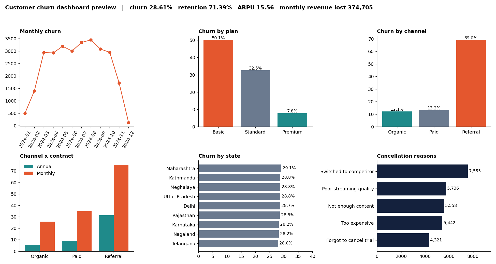
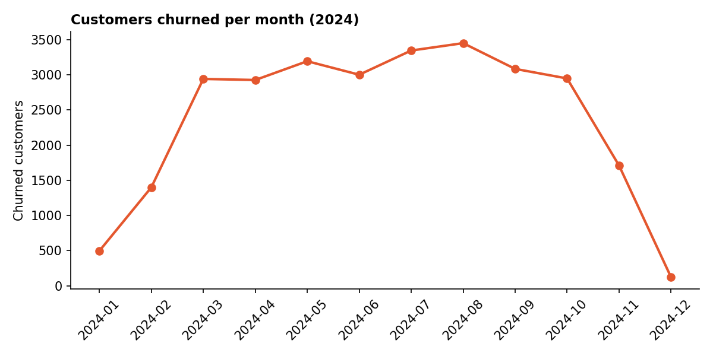
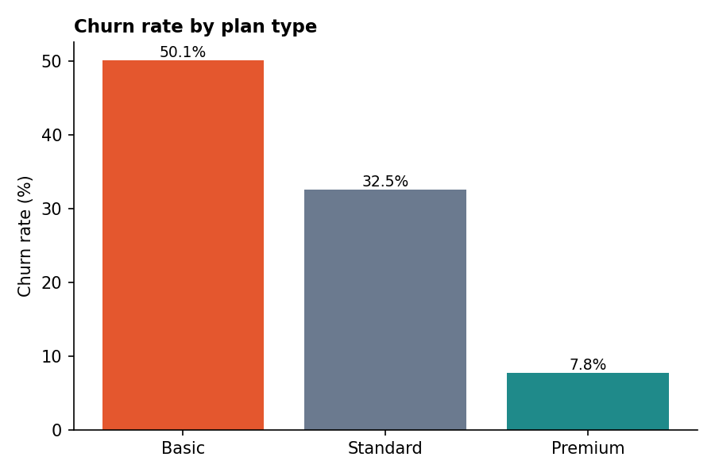
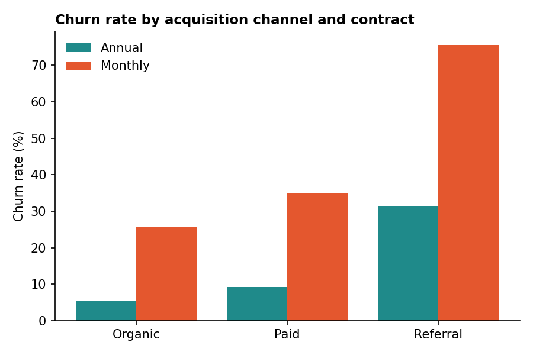
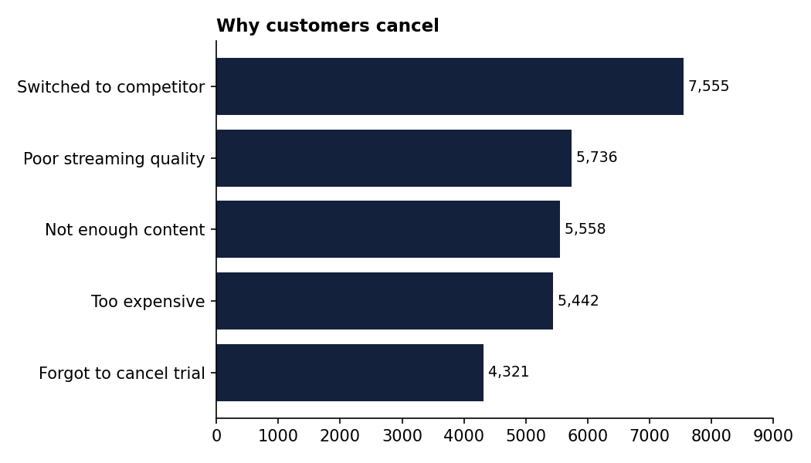
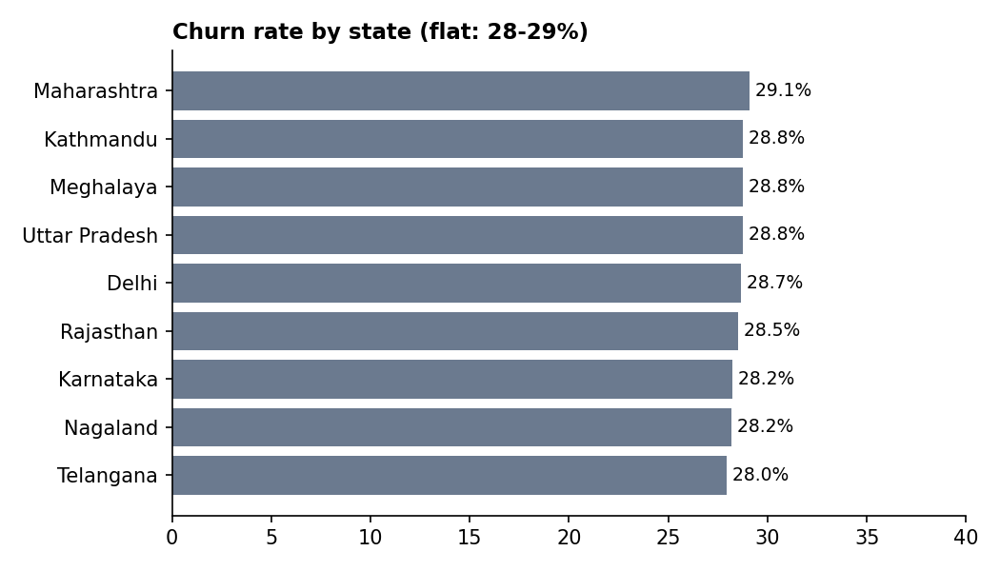
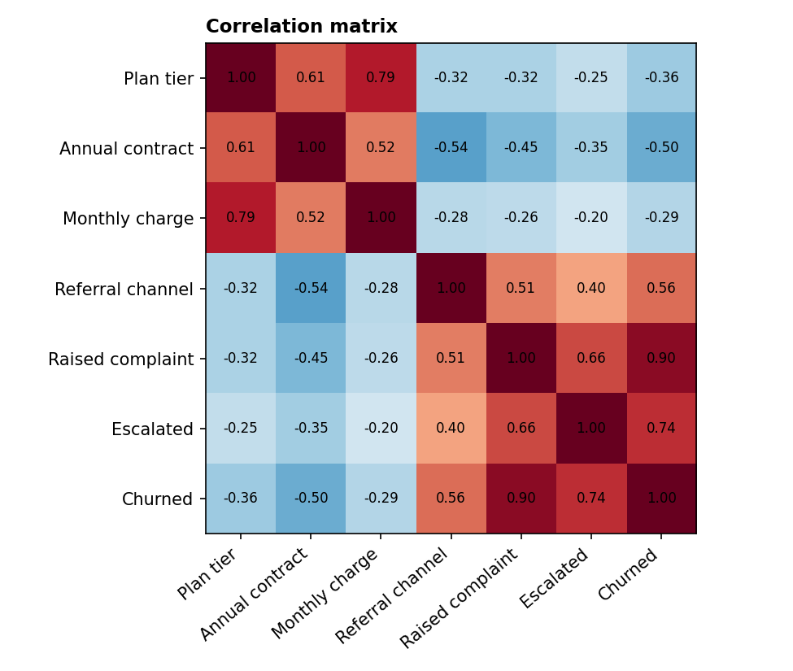
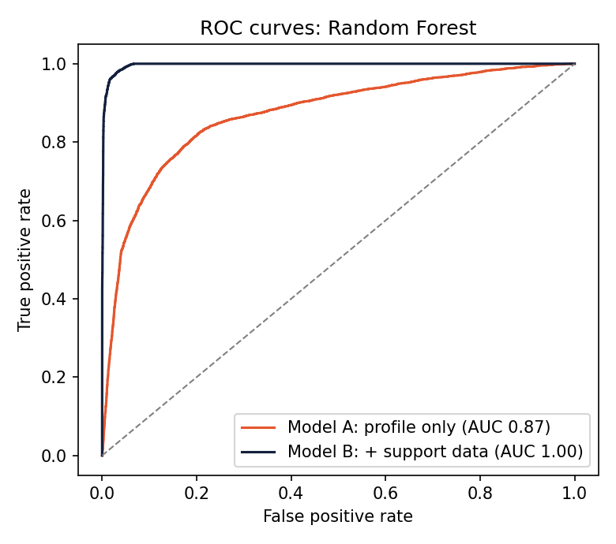
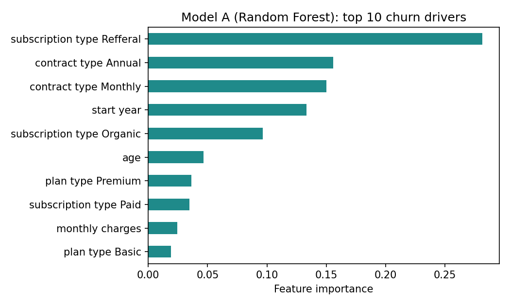

# Customer Churn Analysis for a Subscription Business

Analysis of **100,000 subscribers** to find who churns, why, and how much revenue it costs, using **SQL, Python, machine learning and an interactive dashboard**.

**Tools:** Python (pandas, NumPy, scikit-learn) · SQLite / SQL · Matplotlib · Seaborn · Chart.js · Power BI · Jupyter



**[Open the live dashboard](https://shivanisahu2903.github.io/customer-churn-analysis/dashboard.html)** · [Notebook](churn_analysis_project.ipynb) · [SQL queries](churn_analysis_queries.sql) · [Model script](churn_model.py)

---

## Key Findings

| Finding | Evidence |
|---|---|
| **28.61%** of customers cancelled in 2024 | 28,612 of 100,000 customers; about **374,705** in monthly recurring revenue lost |
| **Contract type is the strongest driver** | Monthly 55.04% churn vs Annual 8.98% |
| **Referral customers churn the most** | 69.02% vs 12.12% organic and 13.18% paid; 85% of referrals are on monthly contracts, but referral is worst *within* each contract type (75.5% monthly, 31.3% annual) |
| **Basic plan loses half its base** | Basic 50.07%, Standard 32.54%, Premium 7.75% |
| **Newer signups churn faster** | 2023 signups 56.65% vs 9.40% for 2019 |
| **Location does not matter** | All 9 states fall between 27.96% and 29.09% |
| **Top cancellation reason: competitors** | Switched to competitor 26.4%, poor streaming quality 20.1%, not enough content 19.4%, too expensive 19.0%, forgot to cancel trial 15.1% |
| **Support contact is a very strong signal** | Customers who never complained: 0% churn. Customers with an escalated latest ticket: 100% churn, with CSAT 20.7 vs 60.7 for non-escalated |

## Business Problem

A subscription service wants to know:
1. What is the overall churn rate, and which customer segments drive it?
2. How much revenue is lost to churn?
3. Why do customers cancel?
4. Can churn be predicted early enough to act?

## Dataset

SQLite database `customer_churn_1.db`, three tables joined on `customerid`:

| Table | Rows | Contents |
|---|---|---|
| `db_customer` | 100,000 | name, country, state, gender, date of birth, interests, pincode |
| `db_subscription` | 100,000 | start, renewal and cancellation dates, channel, plan, contract, monthly charges, CLTV, churn score, cancellation reason |
| `db_support` | 43,362 | complaint date, escalation flag, CSAT score (33,329 customers) |

Churn is defined as a customer having a `cancellation_date`. All cancellations fall between January and December 2024.

## Workflow

```
SQLite DB -> SQL / pandas -> Cleaning -> Feature engineering -> KPIs and EDA -> Dashboard -> Churn model
```

### Data cleaning
| Issue | Fix |
|---|---|
| Ambiguous `name` column | Renamed to `customer_name` |
| `pincode` 100% empty, `interests` 81% empty, `col_1` empty, `comment` 58% empty | Dropped |
| Dates stored as text | Converted to datetime |
| Gender labels `Men` / `Women` mixed with `Male` / `Female` | Standardised |
| 14,208 missing `country` values (14.2%) | Imputed from the state-to-country mapping (e.g. Kathmandu to Nepal) |
| Several support tickets per customer | Counted tickets, then kept the latest per customer so the join stays one row per customer |

### Feature engineering
`churn_flag`, `tenure_days`, `estimated revenue` (monthly charge ÷ 30 × tenure), `complaint_count`, `escalated`, `age`, `signup_year`, `cancel_month`, `churn_risk` band.

## SQL

[`churn_analysis_queries.sql`](churn_analysis_queries.sql) contains 20+ queries, all tested on the database:
- A reusable `vw_customer_360` **view** that applies the cleaning rules in SQL
- Data-quality checks, KPIs, segment analysis (plan, contract, channel, state, cohort)
- **Window functions** (`RANK`, `ROW_NUMBER`, running totals, share of total), **CTEs** and multi-table joins
- Support analysis and a ranked retention action list

```sql
-- Is referral churn just a contract-mix effect?
SELECT subscription_type, contract_type, COUNT(*) AS customers,
       ROUND(100.0 * AVG(churn_flag), 2) AS churn_rate_pct
FROM vw_customer_360
GROUP BY subscription_type, contract_type;
```

## Dashboard

- **Interactive web dashboard:** [`dashboard.html`](dashboard.html), built with Chart.js, deployed on GitHub Pages.
- Download it and open it in any browser. A cleaned, privacy-safe dataset for BI tools such as Power BI or Tableau is in [`churn_powerbi_dataset.csv`](churn_powerbi_dataset.csv).

| | |
|---|---|
|  |  |
|  |  |
|  |  |

## Churn Prediction Model

Script: [`churn_model.py`](churn_model.py). Logistic Regression and Random Forest, 80/20 stratified split.

**Leakage handling.** These columns were excluded because they contain the answer:
- `churn_score`: every churned customer scores 75 or more and every active customer 64 or less, so it simply restates the outcome
- `cancellation_date`, `cancellation_reason`, `tenure_days`: only exist after the customer leaves
- `cltv`: closely tied to how long the customer stayed (correlation of -0.52 with churn)

| Model | Features | ROC-AUC | Churn precision | Churn recall |
|---|---|---|---|---|
| Logistic Regression A | Profile only | 0.856 | 0.749 | 0.645 |
| **Random Forest A** | Profile only | **0.871** | 0.765 | 0.638 |
| Random Forest B | Profile + complaint and escalation flags | 0.997 | 0.953 | 0.963 |

*Profile = plan, contract, channel, state, gender, monthly charge, age, signup year.*

- **Model A** is the realistic baseline for scoring customers *before* they contact support. Top drivers: referral channel, contract type, signup year.
- **Model B** is nearly perfect because in this dataset support contact almost always precedes cancellation. It is shown to illustrate the signal, and real deployments should confirm the complaint happens early enough to act on.

 

## Recommendations

1. **Move monthly customers to annual contracts.** It is the single largest lever (55% vs 9% churn). Offer a discount or bonus month for switching.
2. **Audit the referral programme.** Referral churn is 69%, and still 75.5% on monthly contracts. Review incentives and the onboarding of referred users.
3. **Upgrade Basic users.** Test trial upgrades to Standard or Premium, which churn at far lower rates.
4. **Act on escalations.** Treat an escalated ticket as a save-the-customer trigger (call-back, credit) within days.
5. **Fix the competitive and quality gap.** 66% of exits cite competitors, streaming quality or content. Share this with product teams.
6. **Check trial cancellations.** 15% forgot to cancel a trial, so improve reminders and pre-renewal messaging.
7. **Do not target by state.** There is no signal there.

## Limitations

- Data covers cancellations in one year, so seasonality cannot be assessed. December is partial (data ends 20 Dec).
- Customers who never complained show 0% churn, a pattern that looks synthetic. Treat complaint-based results with care.
- Estimated revenue uses a monthly charge ÷ 30 approximation and ignores plan changes and discounts.
- Age and tenure use a fixed reference date of 31 Dec 2024 so results are reproducible.

## Next Steps
Survival analysis on tenure, probability calibration and threshold tuning by revenue at risk, and an automated refresh of the dashboard.

## Run It Yourself

```bash
git clone https://github.com/shivanisahu2903/customer-churn-analysis.git
cd customer-churn-analysis
pip install -r requirements.txt
jupyter notebook churn_analysis_project.ipynb     # full analysis
python churn_model.py                              # churn model (needs customer_churn_1.db here)
sqlite3 customer_churn_1.db < churn_analysis_queries.sql
```

## Repository Structure

```
customer-churn-analysis/
├── README.md
├── churn_analysis_project.ipynb     # cleaning, EDA, visuals
├── churn_analysis_queries.sql       # SQL analysis and customer 360 view
├── churn_model.py                   # churn prediction model
├── dashboard.html                   # interactive dashboard
├── churn_powerbi_dataset.csv        # cleaned data for Power BI
├── requirements.txt
└── images/                          # charts used in this README
```

## About Me

**Shivani Sahu**, aspiring Data Analyst
[LinkedIn](linkedin.com/in/shivani-sahu-822a28234) · [Email](shivanisahu2903@gmail.com) · [GitHub](https://github.com/shivanisahu2903)
